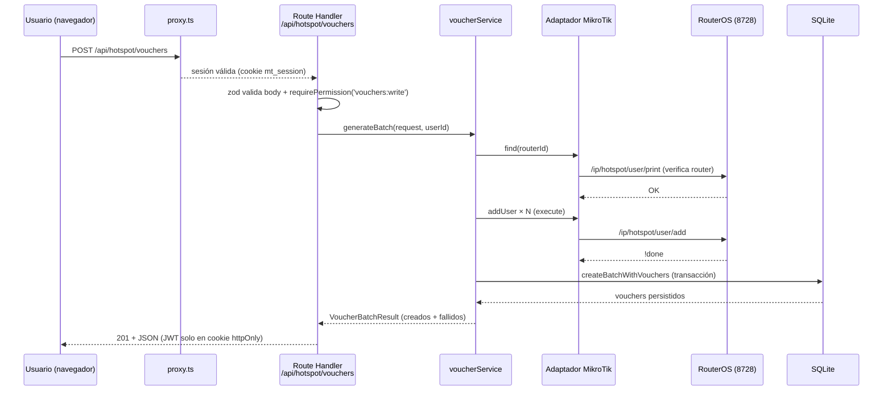

# MikroTik Web Manager

Panel web para la gestión de **Hotspot MikroTik** (routers, usuarios, perfiles,
vouchers, sesiones y reportes), inspirado en **Mikhmon v3**.

- **Stack:** Next.js (App Router) · TypeScript · Tailwind CSS · SQLite
  (`better-sqlite3`) · wrapper propio de la API RouterOS
  (`@fibercom/routeros-api`).
- **Estado:** **Completo (10/10 pasos)** — persistencia real, autenticación,
  CRUD de routers, monitoreo en vivo, hotspot, vouchers, impresión QR, reportes
  y hardening (rate-limit + auditoría). **353 tests en verde.**

📐 El diseño completo está en **[ARCHITECTURE.md](./ARCHITECTURE.md)**.

## Requisitos

- Node.js **≥ 22** (probado con v24)
- Un router MikroTik con **API habilitada** (`/ip service enable api`), puerto
  8728 (o 8729 con `api-ssl`).

## Puesta en marcha

```bash
npm install
cp .env.example .env.local   # y completar SESSION_SECRET / ENCRYPTION_KEY
npm run db:migrate           # crea el esquema en data/
npm run db:seed              # datos de ejemplo (owner / admin12345)
npm run dev                  # http://localhost:3000 → /login
```

> `db:migrate` y `db:seed` cargan `.env.local`/`.env` por su cuenta (`scripts/load-env.ts`),
> así que no hace falta exportar las variables en la terminal.

Generar secretos:

```bash
openssl rand -base64 48   # → SESSION_SECRET
openssl rand -base64 32   # → ENCRYPTION_KEY
```

Si no tienes `openssl` (por ejemplo en Windows), con Node:

```bash
node -e "console.log(require('crypto').randomBytes(48).toString('base64'))"   # SESSION_SECRET
node -e "console.log(require('crypto').randomBytes(32).toString('base64'))"   # ENCRYPTION_KEY
```

## Scripts

| Script | Descripción |
|---|---|
| `npm run dev` | Servidor de desarrollo |
| `npm run build` | Build de producción |
| `npm run start` | Servir el build |
| `npm run typecheck` | `tsc --noEmit` |
| `npm run lint` | ESLint |
| `npm test` | Tests (Vitest) |
| `npm run test:coverage` | Tests + cobertura v8 |
| `npm run db:migrate` | Aplica migraciones pendientes (idempotente) |
| `npm run db:seed` | Inserta datos de desarrollo (idempotente) |

## Puertos

| Servicio | Puerto | Protocolo | Notas |
|---|---|---|---|
| Panel web (Next.js) | **3000** | HTTP | `npm run dev` / `npm run start`. Configurable con `-p`. |
| API RouterOS (MikroTik) | **8728** | TCP (sin TLS) | `/ip service enable api`. Usado por defecto (`protocol: api`). |
| API RouterOS SSL (MikroTik) | **8729** | TCP + TLS | `/ip service enable api-ssl`. Usado con `protocol: api-ssl`. |
| SQLite | archivo | — | `data/mikrotik-manager.sqlite`. Sin puerto (embebido). |

El panel se conecta al router por el puerto configurado al darlo de alta
(`router.port`, por defecto `8728`). Si el equipo no responde, la API devuelve
**502/504** con `error.details.mikrotikCode` (`CONNECTION_REFUSED`,
`CONNECTION_TIMEOUT`, `AUTH_FAILED`), nunca un 500 genérico.

### Flujo de una petición (ejemplo: generar un lote de vouchers)



### Capas y responsabilidades

| Capa | Ubicación | Responsabilidad |
|---|---|---|
| **UI** | `src/app/(dashboard\|hotspot)/*` | Server Components resuelven el primer listado; Client Components pintan y mutan vía `/api/*`. |
| **Proxy** | `src/proxy.ts` | Comprobación optimista de firma de la cookie; redirige a `/login` sin sesión. |
| **API** | `src/app/api/**/route.ts` | Validación zod del borde, autorización (`requirePermission`), traducción `Result`/`MikrotikError` → HTTP (`handleRoute`). |
| **Servicios** | `src/core/services/*` | Casos de uso; devuelven `Result<T>` para lo esperado y **lanzan** `MikrotikError` para fallos de infraestructura. |
| **Adaptador MikroTik** | `src/core/mikrotik/*` | `client.ts` (protocolo), `transport.ts` (socket), `pool.ts` (1 conexión por router), `commands/*` (builders puros), `parsers.ts` (anticorrupción). |
| **Repositorios** | `src/database/repositories/*` | SQL con prepared statements; `BaseRepository` (CRUD, paginación, borrado lógico). |
| **Base de datos** | `src/database/migrations/*` + `data/*.sqlite` | SQLite embebido, esquema versionado con checksums. |

### App Router — rutas de la aplicación

| Ruta | Tipo | Descripción |
|---|---|---|
| `/` | redirect | → `/dashboard` |
| `/login` | página | Formulario de autenticación |
| `/dashboard` | página | Panel principal |
| `/dashboard/routers` | página | CRUD de routers + prueba de conexión |
| `/dashboard/monitoring` | página | Monitoreo en vivo (CPU, memoria, tráfico) |
| `/hotspot/users` | página | Usuarios hotspot (alta, baja, filtros) |
| `/hotspot/profiles` | página | Perfiles de velocidad/tiempo |
| `/hotspot/active` | página | Sesiones activas + desconexión |
| `/hotspot/vouchers` | página | Generación por lote, venta, revocación |
| `/hotspot/vouchers/print` | API | `buildPrintJob` (QR/card/thermal/a4-grid) |

### API REST — endpoints por dominio

| Dominio | Rutas principales |
|---|---|
| **Auth** | `POST /api/auth/login` · `POST /api/auth/logout` · `GET /api/auth/me` |
| **Routers** | `GET/POST /api/routers` · `GET/PATCH/DELETE /api/routers/[id]` · `POST …/test` · `GET …/snapshot` · `GET …/interfaces` |
| **Hotspot** | `GET/POST /api/hotspot/users` · `DELETE /api/hotspot/users/[id]` · `GET/POST /api/hotspot/profiles` · `DELETE …/[id]` · `GET /api/hotspot/active` · `DELETE …/[id]` · `GET /api/hotspot/hosts` |
| **Vouchers** | `GET/POST /api/hotspot/vouchers` · `POST …/[id]/sell` · `POST …/[id]/revoke` · `GET /api/hotspot/vouchers/print` |
| **Sistema** | `GET /api/health` |

## Autenticación

- Login en `/login`; el formulario llama a `POST /api/auth/login`, que deposita
  el JWT en una cookie **httpOnly** (`mt_session`). El token nunca viaja en el
  JSON de respuesta ni es legible desde JavaScript.
- `src/proxy.ts` protege `/dashboard` y `/hotspot` y redirige a `/login?next=…`
  sin sesión válida. Es una comprobación **optimista**: la autorización real la
  aplican los Route Handlers.
- Roles y permisos: `viewer` < `reseller` < `operator` < `admin` < `owner`
  (matriz en `src/core/auth/authz.ts`).

| Método | Ruta | Descripción |
|---|---|---|
| `POST` | `/api/auth/login` | `{ username, password }` → `{ user, session }` + cookie |
| `POST` | `/api/auth/logout` | Revoca el `jti` y borra la cookie (idempotente) |
| `GET` | `/api/auth/me` | `{ user, permissions }` de la sesión actual |

Credenciales del seed: `owner` / `admin12345` (cámbialas en producción).

## Routers y monitoreo

La contraseña de cada router se guarda **cifrada** (AES-256-GCM) y nunca vuelve
al navegador.

- Todas exigen `routers:read` (lecturas) o `routers:write` (mutaciones).
- Si el equipo no responde, la respuesta es **502/504** con
  `error.details.mikrotikCode` (p. ej. `CONNECTION_REFUSED`, `CONNECTION_TIMEOUT`,
  `AUTH_FAILED`), no un 500 genérico.
- UI: `/dashboard/routers` (alta, edición, prueba de conexión) y
  `/dashboard/monitoring` (CPU, memoria, uptime y tráfico por interfaz, con
  sondeo cada 4 s y botones de pausa/refresco).

## Estructura

```
src/
├─ app/         # UI (App Router) + API routes — mapa arriba
├─ core/        # mikrotik/ (adaptador RouterOS) + services/ (casos de uso)
├─ database/    # db.ts, migrate.ts, migrations/, seed.ts, repositories/
├─ lib/         # env.ts, crypto.ts, utils.ts, rate-limit.ts, voucher-code.ts (capa hoja)
└─ types/       # index.ts — contratos globales
scripts/        # CLI (db-migrate.ts, db-seed.ts)
```

## Base de datos

- Esquema versionado en `src/database/migrations/NNNN_*.sql`. Una migración ya
  aplicada es **inmutable** (el runner verifica su checksum).
- El archivo vive en `data/mikrotik-manager.sqlite` (ignorado por git) y se crea
  al ejecutar `npm run db:migrate`.
- Tablas principales: `users`, `routers`, `reseller_profiles`, `voucher_batches`,
  `vouchers`, `transactions`, `audit_log`.

## Verificar

```bash
npm run typecheck
npm test
npm run build
# luego:  GET http://localhost:3000/api/health
```
